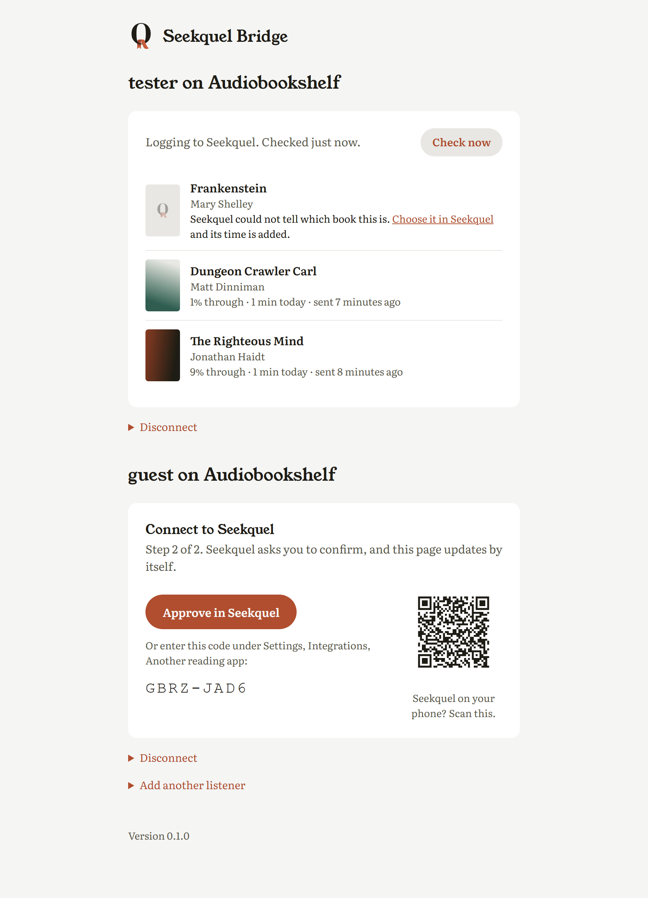

# Seekquel Bridge

Connects the book servers you host yourself to [Seekquel](https://seekquel.app).

You run it next to your server. When you read or listen there, it tells Seekquel where you are in each book, when you finish it, and, if your server records it, how long you read or listened that day. You never open Seekquel to log anything.

| Server | What arrives in Seekquel |
| --- | --- |
| [Audiobookshelf](https://www.audiobookshelf.org) | Listening time, your place in audiobooks and ebooks, finished books |
| [Storyteller](https://storyteller-platform.gitlab.io/storyteller/) | Your place, finished books. Storyteller keeps no reading time, so none is sent |

More servers are on the way.

## Install

On the machine that runs your server:

```bash
curl -fsSL https://raw.githubusercontent.com/sabristratos/seekquel-bridge/main/install.sh | sh
```

On Windows with Docker Desktop, in PowerShell:

```powershell
irm https://raw.githubusercontent.com/sabristratos/seekquel-bridge/main/install.ps1 | iex
```

The command finds Audiobookshelf or Storyteller, starts the Bridge beside it and prints one address. Open it and:

1. Sign in with the account you read or listen with on your server.
2. Tap **Approve in Seekquel** and confirm. If Seekquel is on your phone, scan the code on the page instead.

That is all. There is no file to edit and no token to copy. It starts by itself after a restart, and running the same command again updates it.

  

## What it sends

| | |
| --- | --- |
| Reading or listening time | Counted on the day it happened, where your server records it |
| Your place | The book shows as currently reading, at the right spot |
| Finished | The book is marked finished the day you finish it |
| Reading again | After a few minutes of reading or listening, a book you finished starts a new read |

It sends the book's title, author, ISBN and ASIN so Seekquel can find the right book. Your server password is used once to sign in and is not kept. The sign-in it gets back stays in this program and is never sent to Seekquel.

It starts from the moment you connect it. Nothing from before that is sent. Podcasts are skipped.

## Updates

When a new version is out, the Bridge's page and the Seekquel Bridge screen in Seekquel both say so. To update, run the install command again: your accounts and your connection to Seekquel are kept. On Unraid, apply the update from the Docker tab. With Docker Compose, `docker compose pull` and `docker compose up -d`. If you run [Watchtower](https://containrrr.dev/watchtower/), it updates the Bridge by itself.

## The page

The page lists every book it is following, with today's time and when it was last sent. **Check now** sends straight away. **Disconnect** stops logging for one account.

## A book that does not show up

If Seekquel cannot tell which book something is, the page says so beside the book, with a link to the screen in Seekquel where you choose it. Any time already recorded is added then.

If a book lands on the wrong edition, change the edition on its page in Seekquel. The Bridge does not change it back.

## Disconnect

Choose **Disconnect** on the page, then remove Seekquel Bridge in Seekquel under Settings, Integrations.

To remove it from your machine:

```bash
docker rm -f seekquel-bridge
```

```bash
docker volume rm seekquel-bridge-data
```

## Docker Compose, Unraid, Synology

On Unraid, add `unraid/seekquel-bridge.xml` as a template. If you manage containers yourself, `docker-compose.example.yml` is all you need. No settings are required: open port 4410 afterwards and the same two steps appear. If the Bridge cannot find your server by itself, the sign-in page asks for its address.

## Optional settings

| Variable | Default | What it does |
| --- | --- | --- |
| `ABS_URL` | found automatically | Address of Audiobookshelf, as this program reaches it |
| `ABS_TOKEN` | none | An Audiobookshelf API key, if you would rather not sign in on the page |
| `ABS_LIBRARIES` | all | Comma-separated Audiobookshelf library ids to include |
| `STORYTELLER_URL` | found automatically | Address of Storyteller, as this program reaches it |
| `POLL_SECONDS` | 300 | How often it checks when your server has not said anything changed. 60 is the lowest |
| `STATUS_PORT` | 4410 | Port of the page |
| `DEVICE_NAME` | Seekquel Bridge | The name shown in Seekquel's list of connected apps |

## More than one person or server

One Bridge serves a whole household and every server on the machine. Each person opens the page, chooses **Add another account**, signs in with their own account on a server and approves their own Seekquel account. Someone who uses both Audiobookshelf and Storyteller adds each one.

## Build it yourself

```bash
npm install
```

```bash
npm test
```

```bash
docker build -t seekquel-bridge .
```

## Licence

MIT
