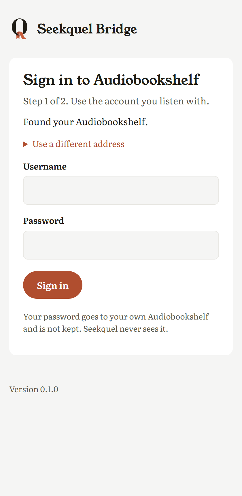
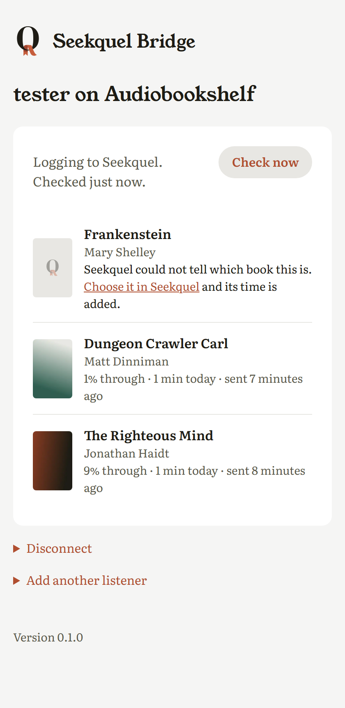

# Seekquel Bridge

Logs what you listen to on your own Audiobookshelf server into [Seekquel](https://seekquel.app).

You run it next to Audiobookshelf. It notices within about half a minute when you listen and tells Seekquel three things about each book: how long you listened today, where you are, and when you finish. You never open Seekquel to log anything.

## Install

On the machine that runs Audiobookshelf:

```bash
curl -fsSL https://raw.githubusercontent.com/sabristratos/seekquel-bridge/main/install.sh | sh
```

On Windows with Docker Desktop, in PowerShell:

```powershell
irm https://raw.githubusercontent.com/sabristratos/seekquel-bridge/main/install.ps1 | iex
```

The command finds your Audiobookshelf, starts the Bridge beside it and prints one address. Open it and:

1. Sign in with your Audiobookshelf username and password.
2. Tap **Approve in Seekquel** and confirm. If Seekquel is on your phone, scan the code on the page instead.

That is all. There is no file to edit and no token to copy. It starts by itself after a restart, and running the same command again updates it.

  

## What it sends

| | |
| --- | --- |
| Listening time | Counted on the day you listened |
| Your place | The book shows as currently reading, at the right spot |
| Finished | The book is marked finished the day you finish it |

It sends the book's title, author, ISBN and ASIN so Seekquel can find the right book. Your Audiobookshelf password is used once to sign in and is not kept. The sign-in it gets back stays in this program and is never sent to Seekquel.

It starts from the moment you connect it. Listening from before that is not sent. Podcasts are skipped.

## The page

The page lists every book it is following, with today's listening and when it was last sent. **Check now** sends straight away. **Disconnect** stops logging for one listener.

## A book that does not show up

If Seekquel cannot tell which book something is, the page says so beside the book, with a link to the screen in Seekquel where you choose it. The time already listened is added then.

If a book lands on the wrong edition, change the edition on its page in Seekquel. The Bridge does not change it back.

## Disconnect

Choose **Disconnect** on the page, then remove Seekquel Bridge in Seekquel under Settings, Integrations.

To remove it from your server:

```bash
docker rm -f seekquel-bridge
```

```bash
docker volume rm seekquel-bridge-data
```

## Docker Compose, Unraid, Synology

On Unraid, add `unraid/seekquel-bridge.xml` as a template. If you manage containers yourself, `docker-compose.example.yml` is all you need. No settings are required: open port 4410 afterwards and the same two steps appear. If the Bridge cannot find Audiobookshelf by itself, the sign-in page asks for its address.

## Optional settings

| Variable | Default | What it does |
| --- | --- | --- |
| `ABS_URL` | found automatically | Address of Audiobookshelf, as this program reaches it |
| `ABS_TOKEN` | none | An Audiobookshelf API key, if you would rather not sign in on the page |
| `ABS_LIBRARIES` | all | Comma-separated library ids to include |
| `POLL_SECONDS` | 300 | How often it checks when Audiobookshelf has not said anything changed. 60 is the lowest |
| `STATUS_PORT` | 4410 | Port of the page |
| `DEVICE_NAME` | Seekquel Bridge | The name shown in Seekquel's list of connected apps |

## More than one listener

One Bridge serves a whole household. Each person opens the page, chooses **Add another listener**, signs in with their own Audiobookshelf account and approves their own Seekquel account.

## Build it yourself

```bash
npm install
```

```bash
npm test
```

```bash
docker build -t seekquel-bridge .
```

## Licence

MIT
